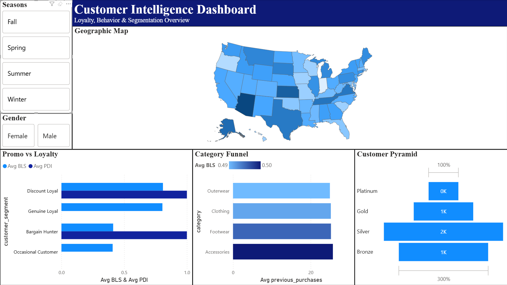

# Decoding Customer Value: A SQL-Driven Retention Strategy

Which customers are genuinely loyal, and which only show up for the discount? A customer analytics project for a US-based D2C fashion brand.

**Stack:** Python · PostgreSQL · Power BI · Excel

---

## The Problem

The brand had data on about 3,900 customers and leaned heavily on promotions, but it couldn't tell whether discounts were building loyalty or just attracting price-sensitive buyers.

This project builds a framework to answer one question: **is the business creating loyal customers, or does it depend on constant promotions to sell?**

It breaks that into five parts:

- Who is truly loyal, and who is driven by discounts?
- What behaviors go with higher customer value?
- Which geographic and demographic segments are underused?
- How can promotions be restructured without hurting retention?
- What does the ideal customer look like?

---

## Approach

### 1. Cleaning and feature engineering (Python)

I standardized column names, imputed missing review ratings with category-level medians, encoded binary promo and subscription fields, ordered the purchase-frequency categories, and normalized variables for the composite scores.

| Metric | What it captures |
|---|---|
| **eLTV** | Estimated value from purchase amount and past purchases |
| **PDI** (Promo Dependency Index) | How much a customer relies on promotions |
| **BLS** (Behavioural Loyalty Score) | Repeat-purchase behavior |
| **ELS** (Economic Loyalty Score) | Spending, subscriptions, and promo independence |
| **RQI** (Revenue Quality Index) | Spending, satisfaction, and promo independence |
| **Value Tier** | Bronze, Silver, Gold, Platinum |
| **Sentiment Flag** | Detractor, Passive Buyer, Brand Promoter |

### 2. Segmentation and SQL analysis (PostgreSQL)

Customers fall into four segments based on BLS and PDI:

| Segment | Rule |
|---|---|
| Genuine Loyal | BLS ≥ 0.70 and PDI ≤ 0.30 |
| Discount Loyal | BLS ≥ 0.70 and PDI > 0.30 |
| Bargain Hunter | BLS < 0.70 and PDI > 0.50 |
| Occasional | Everyone else |

The queries also cover value drivers, retention vs. acquisition categories, seasonality, geographic and demographic opportunities, the ideal customer profile, and promo sunset candidates.

### 3. Founder dashboard (Power BI)

Four panels: Customer Value Pyramid, Promo Dependency vs. Loyalty, Geographic Opportunity, and Product Category Analysis.

### 4. Retention playbook

A 90-day Promotional Sunset Plan and a data-backed Ideal Customer Profile.

---

## Key Findings

| Segment | Customers | Share |
|---|---|---|
| Genuine Loyal | 462 | 11.8% |
| Discount Loyal | 378 | 9.7% |
| Bargain Hunters | 1,299 | 33.3% |
| Occasional | 1,761 | 45.2% |

- **Loyalty is thin.** Only 11.8% of customers are both loyal and low on promo dependence, while a third are Bargain Hunters.
- **Promo dependence is widespread.** About 43% of customers have a PDI above 0.30.
- **Discounts don't always signal low value.** Discount Loyal customers have an estimated LTV of ~$2,633, nearly matching Genuine Loyal at ~$2,660. Cutting discounts across the board would put real value at risk.
- **Demographic gap.** Women aged 25–34 are underrepresented but valuable, with an estimated LTV of $1,658.
- **Geographic upside.** Arizona and Alaska show strong spending with lower promo dependency.
- **Category roles.** Accessories and Footwear are linked to repeat purchases, and Outerwear looks like an acquisition category.

---

## Recommendations

Move from sitewide discounting to a segmented retention strategy, rolled out over 90 days:

| Days | Segment | Action |
|---|---|---|
| 1–30 | Genuine Loyal | Swap discounts for VIP perks, early access, and priority shipping |
| 31–60 | Occasional | Introduce spend-threshold offers to lift basket size |
| 61–90 | Discount Loyal | Phase direct discounts into loyalty credits, bundles, and exclusive benefits |

Bargain Hunters stay eligible for selective promotions, mainly for acquisition and clearing inventory.

---

## Limitations

The dataset has no transaction timestamps, churn labels, or longitudinal purchase records. So:

- eLTV is a proxy, not a true lifetime value.
- BLS and ELS are engineered indicators, not observed loyalty.
- PDI is estimated from discount and promo-code exposure.
- Retention and churn can't be measured directly.
- Category findings show association, not causation.

---

## Repository Structure

```
customer-retention-analytics/
├── data/            # Dataset.csv, Cleaned_Dataset.csv
├── notebooks/       # 01_Data_Cleaning_Feature_Engineering, 02_Customer_Segmentation_SQL
├── sql/             # customer_segmentation_queries.sql
├── dashboard/       # Customer_Retention_Dashboard.pbix, dashboard_preview.png
├── reports/         # Retention_Playbook.pdf, Executive_Summary.pdf
├── requirements.txt
└── README.md
```

---
## Dashboard Preview


*Built for Summer Projects 2026, Consulting & Analytics Club, IIT Guwahati.*
